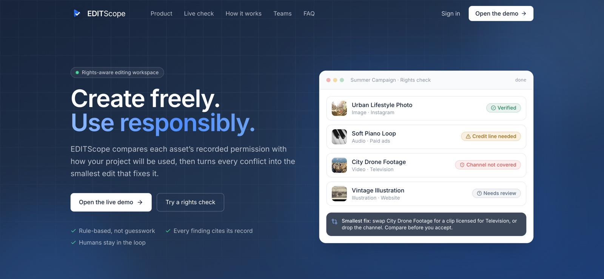
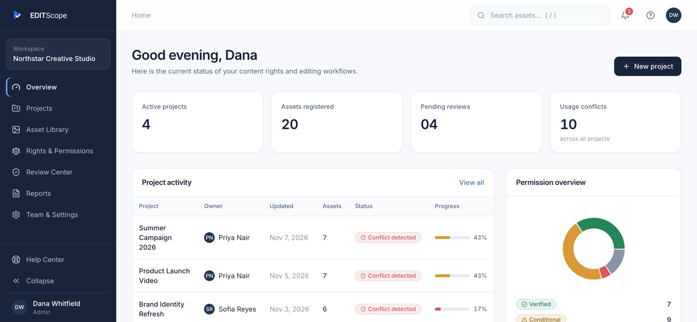
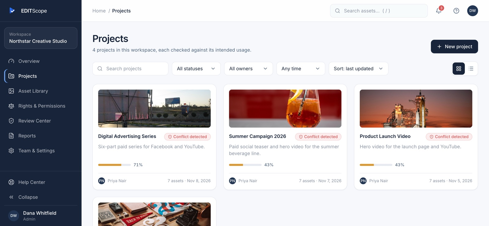
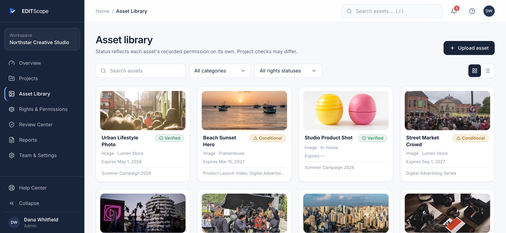
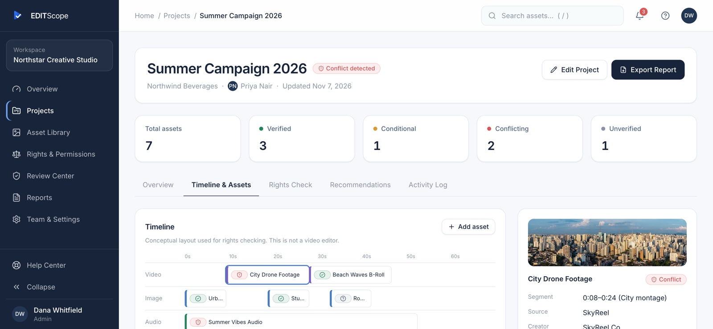
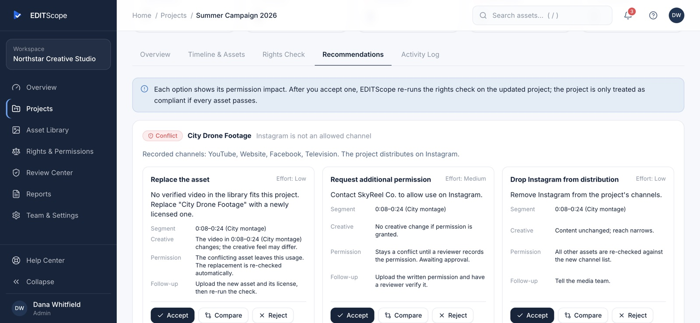
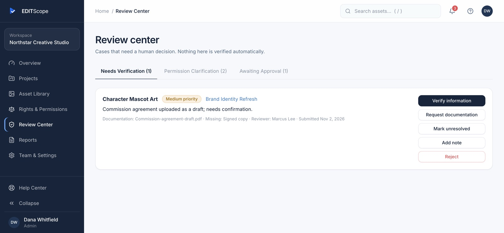
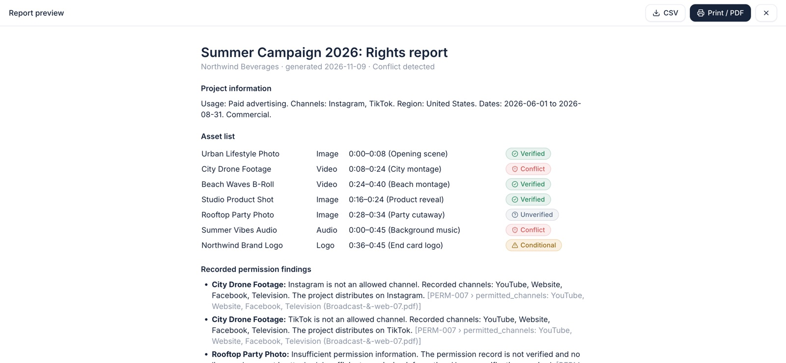
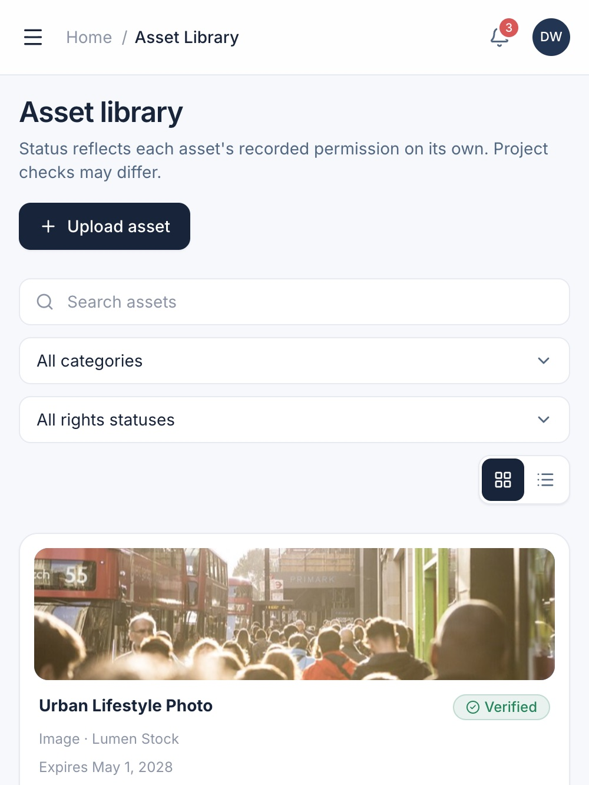

<div align="center">

# EDITScope

### Create freely. Use responsibly.

<p>Ruang kerja editing sadar-hak: mencocokkan izin aset yang tercatat dengan pemakaian proyek yang sebenarnya, lalu menyarankan perbaikan terkecil.</p>

<p>     </p>

<p><a href="https://editscope.vercel.app"><b>Lihat demo langsung &rarr;</b></a></p>
</div>



## Key features

- **Rights check against real usage.** Every asset in a project is checked for expiry, permitted usage, channel, region, commercial use, attribution and required approvals. Each finding cites the license record it came from.
- **Four honest statuses.** *Verified*, *Conditional*, *Conflict* and *Unverified*. Missing information is never treated as permission.
- **Minimum-change recommendations.** For each conflict you get options such as replace the asset, request extra permission, or drop a channel. Compare them side by side, accept one, and the check re-runs automatically.
- **Timeline view.** See which asset sits where in the edit, and its recorded permission, in one click.
- **Human review stays in the loop.** Unclear cases go to a Review Center where a reviewer verifies, asks for documentation, or marks the case unresolved. Uploading a document never verifies a permission by itself.
- **Asset library and permission records.** Upload assets with license details, filter by type or rights status, and keep every license, restriction and expiry in one place.
- **Reports.** Export a project's rights report as PDF (print) or CSV for clients and legal review.
- **Roles.** Admin, Editor, Reviewer and Viewer, each with only the actions they should have.
- **Responsive.** Works from phone to desktop.

## Screenshots

| | |
|---|---|
|  **Overview.** Project status, pending reviews and conflicts at a glance. |  **Projects.** Each project with its overall rights status and progress. |
|  **Asset library.** Every asset with its own recorded permission status. |  **Timeline.** Pick an asset to see where it is used and what its license says. |
|  **Recommendations.** Smallest fixes, with effort and permission impact. |  **Review Center.** A person verifies unclear cases. |
|  **Report.** Print to PDF or export CSV. |  **Mobile.** The same workspace on a phone. |

## Run

```bash
npm install
npm run dev      # http://localhost:5173
npm test         # rights-engine unit tests
npm run build    # typecheck + production build
```

Demo login: `dana@northstar.studio` (Admin), any password of 6+ characters. Use the avatar menu → **View as** to try Admin, Editor, Reviewer and Viewer roles.

## How it works

- `src/engine.ts`: rule-based rights check (expiry, usage, channel, region, commercial use, attribution, required approval) and recommendation generator. It does not use AI or legal reasoning.
- Missing or unverified permission data is always **Unverified**, never treated as allowed or blocked.
- Accepting a recommendation changes the project and **re-runs** the check. It never marks a project compliant on its own.
- A reviewer must verify permissions; documentation alone does not verify.

Built with React, TypeScript, Vite, Tailwind CSS, React Router, Recharts and Vitest.

## Scope of this MVP

- Data is stored in browser `localStorage` (demonstration data). Team & Settings → *Restore demo data* resets it.
- Authentication, invitations and Google sign-in are simulated. Role checks are enforced in the UI only; there is no server or row-level security yet.
- Uploads keep file names and metadata, not file contents.
- PDF export uses the browser print dialog; CSV export is built in.

This tool summarizes recorded permissions and review results. It is not a legal opinion or a guarantee of copyright compliance.

## Credits and license

Demo photos are CC0 or public-domain images from Wikimedia Commons. See [CREDITS.md](CREDITS.md) for each author and source.

Owner and copyright holder: Vassel Goleyu. All rights reserved, see [LICENSE](LICENSE).
